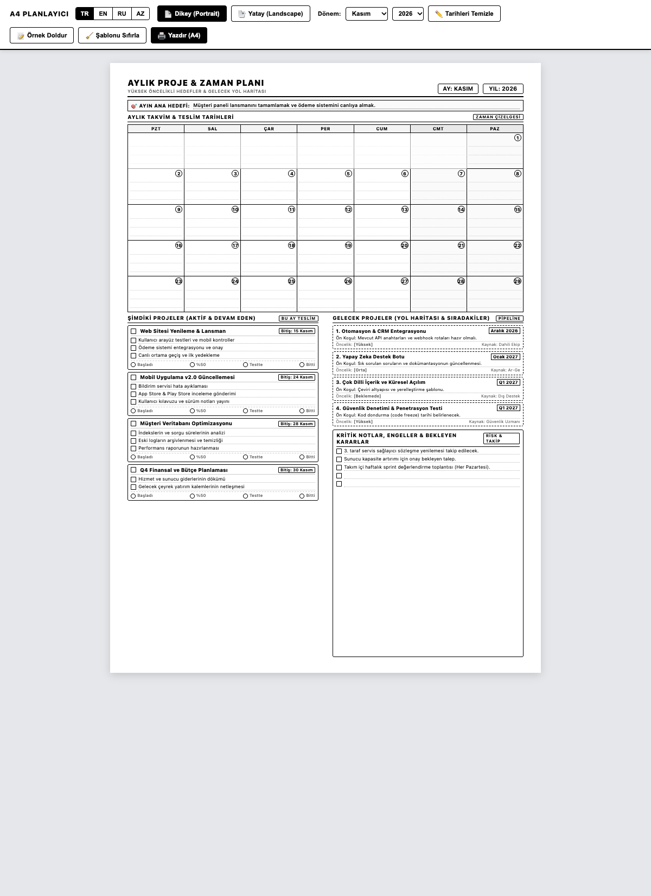
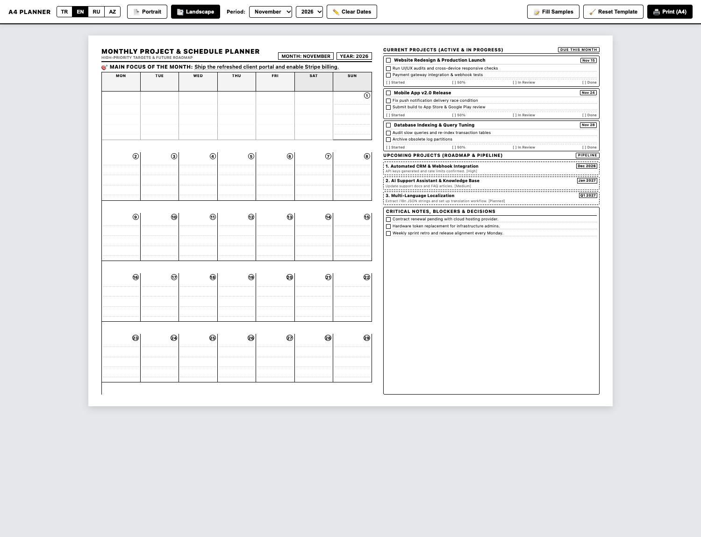

# Aylıq Layihə və Zaman Planlaşdırıcısı (Çap üçün A4)

A4 vərəqinə tək səhifə olaraq çap oluna bilən, qara-ağ, yüksək kontrastlı və mürəkkəbə qənaət edən aylıq layihə və təqvim planlaşdırıcısı.

[ **English** ](README.md) | [ **Türkçe** ](README.tr.md) | [ **Русский** ](README.ru.md) | [ **Azərbaycan** ]

---

## Ekran Görüntüləri

### Şaquli Görünüş (Portrait)


### Üfüqi Görünüş (Landscape)


---

## Əsas Xüsusiyyətlər

- **Qara-Ağ və Mürəkkəbə Qənaət:** Toner və kartric xərcləməyən, təmiz və dəqiq xətlərdən ibarət dizayn.
- **Tək Səhifə A4 Zəmanəti:** Dəqiq CSS çap qaydaları ilə ikinci səhifəyə daşma baş vermir.
- **Çoxdilli Dəstək:** Tək kliklə **Azərbaycan (AZ)**, **İngilis (EN)**, **Türk (TR)** və **Rus (RU)** dillərinə keçid.
- **İki Yerləşmə Formatı:**
  - **Şaquli (Portrait):** Yuxarıda təqvim, aşağıda aktiv layihələr və yol xəritəsi sütunları.
  - **Üfüqi (Landscape):** Solda geniş təqvim xanaları, sağda layihə kartları və qeyd sahəsi.
- **Brauzerdə Birbaşa Redaktə:** Çap etməzdən əvvəl başlıqlar, layihə adları və tapşırıqlar klaviatura ilə birbaşa dəyişdirilə bilər (`contenteditable`).
- **Avtomatik və ya Əllə Tarixləndirmə:** Ay və il seçilərək günlər avtomatik düzülə bilər, yaxud "Tarixləri Təmizlə" düyməsi ilə qələmlə yazmaq üçün boş çap alına bilər.
- **Sıfır Asılılıq:** Framework və ya xarici kitabxana tələb etmir. Sadə HTML, CSS və JavaScript ilə oflayn rejimdə işləyir.

---

## Şablon Bölmələri

1. **Başlıq və Ayın Əsas Hədəfi:** Ay, il və ayın ən vacib nəticə xətti.
2. **Aylıq Təqvim Qəfəsi:** Bazar ertəsi - Bazar aralığında 35 xanalıq təqvim və qeyd sətirləri.
3. **Cari Layihələr (Aktiv):** 4 eyni vaxtda icra olunan layihə, təhvil tarixləri, alt tapşırıq xanaları (`[ ]`) və status göstəriciləri (`Başladı`, `50%`, `Testdə`, `Bitdi`).
4. **Gələcək Layihələr (Yol Xəritəsi):** Növbədə gözləyən layihələr, hədəf tarixlər, ilkin şərtlər və prioritet dərəcəsi.
5. **Kritik Qeydlər və Maneələr:** Təsdiq gözləyən qərarlar, kənar maneələr və risklər üçün xətli qeyd sahəsi.

---

## Tez Başlamaq

### 1. Brauzerdə Açmaq

Terminaldan:
```bash
open index.html
```
və ya fayl menecerində `index.html` faylını iki dəfə klikləyərək açın.

Parametrlərlə açmaq olar:
- `index.html?lang=az&mode=portrait`
- `index.html?lang=az&mode=landscape`

### 2. Çap Parametrləri (`Cmd + P` və ya `Ctrl + P`)

- **Hədəf:** Çap cihazınız və ya "PDF olaraq saxla"
- **Vərəq Ölçüsü:** A4
- **Rəng:** Qara-Ağ / Monoxrom
- **Kənar Boşluqları:** Standart (və ya 8 mm)
- **Parametrlər:** **"Fon qrafikası"** (Background graphics) seçimini aktivləşdirin.

---

## Layihə Strukturu

```text
├── index.html                  # Əsas interaktiv şablon faylı
├── assets/
│   ├── preview-portrait.png    # Şaquli ekran görüntüsü
│   └── preview-landscape.png   # Üfüqi ekran görüntüsü
├── CONTRIBUTING.md             # Töhfə qaydaları
├── LICENSE                     # MIT Lisenziyası
├── README.md                   # İngilis dilində sənədləşmə
├── README.tr.md                # Türk dilində sənədləşmə
├── README.ru.md                # Rus dilində sənədləşmə
└── README.az.md                # Azərbaycan dilində sənədləşmə
```

---

## Töhfə Vermək

Yeni dillər əlavə edə, çap stillərini təkmilləşdirə və ya xətaları bildirə bilərsiniz. Ətraflı məlumat üçün [CONTRIBUTING.md](CONTRIBUTING.md) faylını oxuyun.

---

## Lisenziya

Bu layihə [MIT Lisenziyası](LICENSE) altında açıq mənbəli olaraq təqdim olunur.
