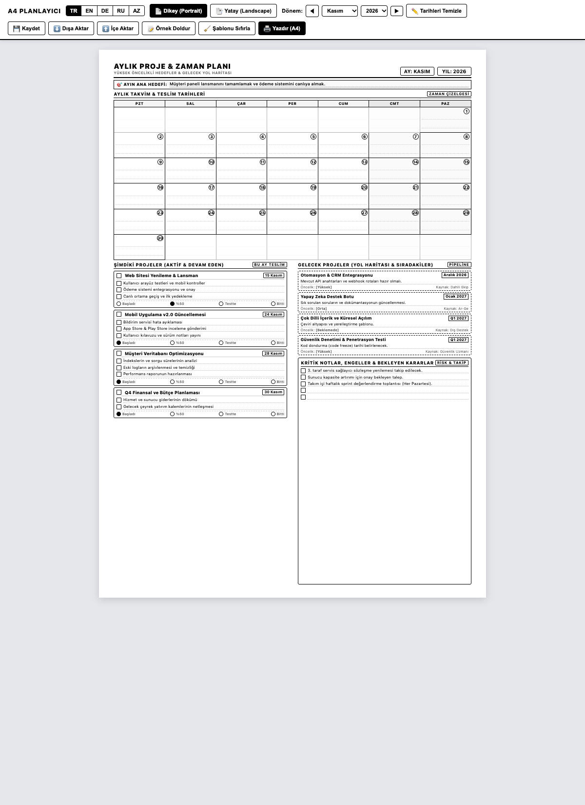
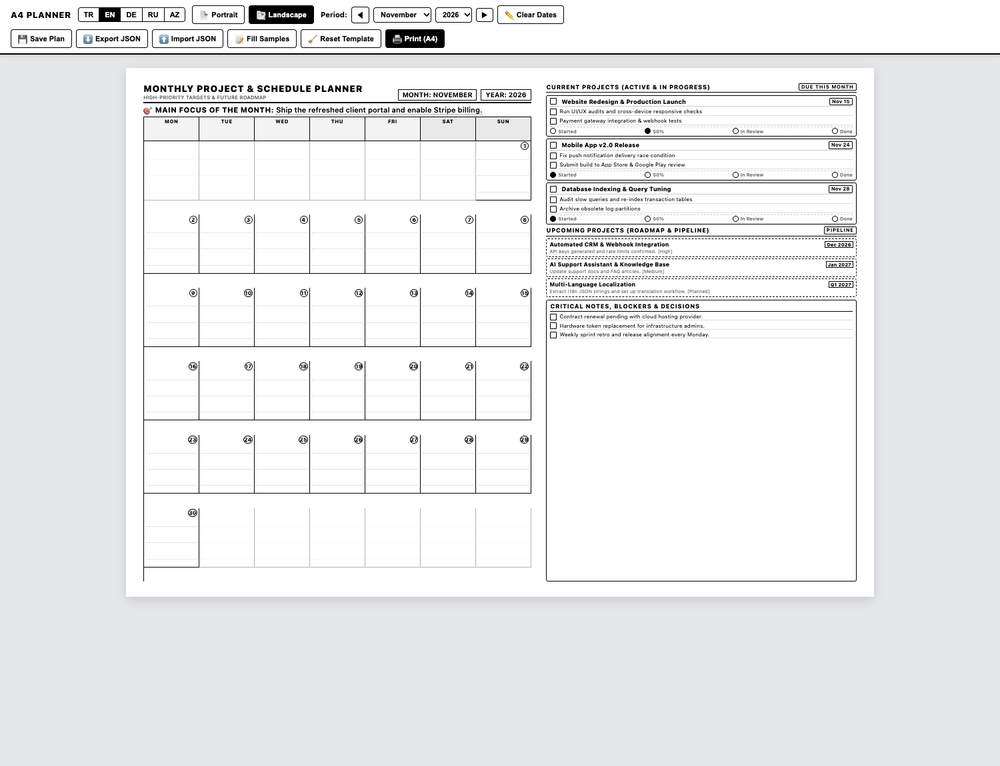

# Monatlicher Projekt- & Kalenderplaner (Druckbares A4)

Ein minimalistischer, tintensparender monatlicher Projekt- und Terminplaner auf einer einzelnen A4-Seite. Entwickelt für den Schwarz-Weiß-Druck auf Papier oder das Speichern als PDF.

[ **English** ](README.md) | [ **Türkçe** ](README.tr.md) | [ **Deutsch** ] | [ **Русский** ](README.ru.md) | [ **Azərbaycan** ](README.az.md)

**Online-Demo:** [https://isihussain.github.io/monthly-project-planner-a4/](https://isihussain.github.io/monthly-project-planner-a4/)

---

## Vorschau

### Hochformat (Portrait)


### Querformat (Landscape)


---

## Hauptfunktionen

- **Tintensparendes Monochrom:** Klare Linien ohne massive schwarze Farbflächen zur Schonung von Druckertinte und Toner.
- **Einzelblatt-Garantie (A4):** Präzise CSS-Druckregeln verhindern unabsichtliche leere Folgeseiten.
- **Vollständiges 42-Zellen-Monatsraster:** 6 Wochenzeilen garantieren, dass Monate wie November 2026 oder März 2026 alle Tage (bis zum 31.) vollständig abbilden.
- **Mehrsprachigkeit:** Umschaltung mit einem Klick zwischen **Deutsch (DE)**, **Englisch (EN)**, **Türkisch (TR)**, **Russisch (RU)** und **Aserbaidschanisch (AZ)**.
- **Zwei Layout-Optionen:**
  - **Hochformat:** Kompakter Kalender oben, zweispaltige Projekt- und Roadmap-Karten unten.
  - **Querformat:** Großzügige Tageszellen links, Aufgaben- und Risikolisten rechts.
- **Direkt im Browser bearbeitbar:** Alle Überschriften, Aufgaben und Notizen können vor dem Ausdruck direkt am Bildschirm editiert werden (`contenteditable`).
- **Zwei-Wege-Synchronisation:** Änderungen im Hochformat werden in Echtzeit ins Querformat übertragen.
- **Lokale Speicherung & Datensicherheit:** Automatische Speicherung im Browser (`localStorage`), JSON-Export und Import mit XSS-geschützter Datenbindung.
- **Keine externen Abhängigkeiten:** Reines HTML5, CSS3 und Vanilla JavaScript. Funktioniert komplett offline.

---

## Struktur des Planers

1. **Monatsfokus & Zeitraum:** Monat, Jahr und die zentrale Zielsetzung des Monats.
2. **Monatskalender (42 Zellen):** Montag bis Sonntag Übersicht mit Datumsplaketten und Notizzeilen pro Tag.
3. **Aktuelle Projekte (Laufend):** Bis zu 4 parallele Projekte mit Fristen, Aufgaben-Checkboxes (`[ ]`) und Statusstufen (`Gestartet`, `50%`, `Im Test`, `Erledigt`).
4. **Zukünftige Projekte (Roadmap & Pipeline):** Vorgemerkte Projekte, Zieltermine, Voraussetzungen und Prioritäten.
5. **Kritische Notizen, Risiken & Hindernisse:** Notizzeilen für ausstehende Freigaben und Entscheidungen.

---

## Schnelleinstieg

### 1. Im Browser öffnen

Im Terminal ausführen:
```bash
open index.html
```
Oder per Doppelklick auf `index.html` im Dateimanager.

Parameter können über die URL übergeben werden:
- `index.html?lang=de&mode=portrait`
- `index.html?lang=de&mode=landscape`

### 2. Druckeinstellungen (`Cmd + P` oder `Ctrl + P`)

- **Ziel:** Drucker oder „Als PDF speichern“
- **Papierformat:** A4
- **Farbe:** Schwarz-Weiß / Monochrom
- **Ränder:** Standard (oder 8 mm)
- **Optionen:** **„Hintergrundgrafiken“** aktivieren (gewährleistet saubere Linien und Rahmen).

---

## Lizenz

Dieses Projekt ist unter der [MIT-Lizenz](LICENSE) lizenziert.
