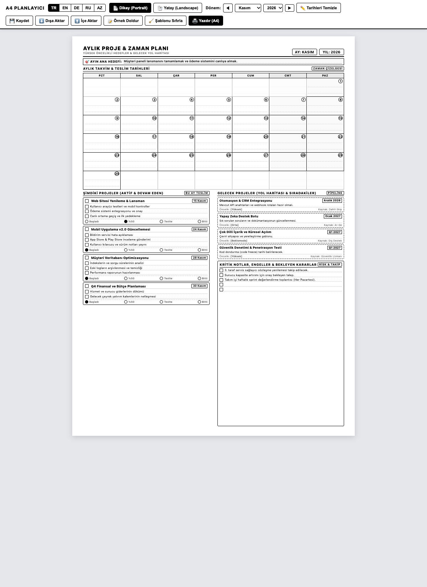
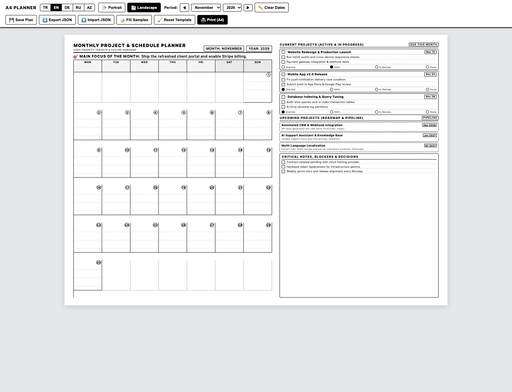

# Monthly Project & Calendar Planner (Printable A4)

A minimalist, ink-friendly, single-page A4 monthly project and schedule planner. Designed for black-and-white printing on paper or saving as PDF.

[ **English** ] | [ **Deutsch** ](README.de.md) | [ **Türkçe** ](README.tr.md) | [ **Русский** ](README.ru.md) | [ **Azərbaycan** ](README.az.md)

**Live Demo:** [https://isihussain.github.io/monthly-project-planner-a4/](https://isihussain.github.io/monthly-project-planner-a4/)

---

## Previews

### Portrait Mode (Default)


### Landscape Mode


---

## Features

- **Ink-Friendly Monochrome:** Pure black and light-gray line work with zero solid black fills to save printer ink and toner.
- **Single-Page A4 Guarantee:** Calibrated to 210mm × 297mm (and 297mm × 210mm landscape) with print CSS rules preventing blank overflow pages.
- **Multilingual Support:** One-click language switching between **English (EN)**, **German (DE)**, **Turkish (TR)**, **Russian (RU)**, and **Azerbaijani (AZ)**.
- **Dual Layouts:**
  - **Portrait:** Top calendar grid, bottom split columns for current projects and roadmap/notes.
  - **Landscape:** Large calendar cells on the left, project lists and critical notes on the right.
- **Interactive Checkboxes:** Toggle task completion with ink-friendly checkmarks (`✓`) and mark project phases.
- **LocalStorage & JSON Export/Import:**
  - Auto-saves edits to browser `localStorage`.
  - Export and import customized plans via portable JSON files.
  - `Ctrl + S` / `Cmd + S` manual quick-save with toast notifications.
- **Quick Month Stepping:** One-click `◀` and `▶` buttons to navigate across months.
- **Browser Editable:** Click any title, task, milestone, or date box to edit directly on screen before printing (`contenteditable`).
- **Dynamic or Manual Dates:** Select year and month to auto-populate calendar days, or click "Clear Dates" to print a blank template for handwritten planning.
- **Zero Dependencies:** Pure vanilla HTML, CSS, and JavaScript. Runs offline without any server, Node.js, or external CDN.

---

## Sections Included

1. **Header & Monthly Focus:** Month, year, and a dedicated high-priority monthly focus milestone line.
2. **Monthly Calendar Grid:** 35-cell Monday-to-Sunday overview with date badges and daily note lines.
3. **Current Projects (Active):** Track up to 4 concurrent projects with deadlines, milestone checkboxes, and progress radio indicators (`Started`, `50%`, `In Review`, `Done`).
4. **Upcoming Projects (Pipeline):** Track queued projects with target delivery dates, prerequisites, and priority levels.
5. **Critical Notes & Blockers:** Lined space for risks, external dependencies, and pending decisions.

---

## Quick Start

### 1. Open in Browser

Run in your terminal:
```bash
open index.html
```
Or double-click `index.html` in your file explorer.

You can also pass URL query parameters:
- `index.html?lang=en&mode=portrait`
- `index.html?lang=tr&mode=landscape`
- `index.html?lang=ru`
- `index.html?lang=az`

### 2. Print Settings (`Cmd + P` or `Ctrl + P`)

- **Destination:** Your printer or "Save as PDF"
- **Paper Size:** A4
- **Color:** Black and White / Monochrome
- **Margins:** Default (or 8mm)
- **Options:** Check **"Background graphics"** (ensures boxes and dotted guidelines render cleanly)

---

## Project Structure

```text
├── index.html                  # Core interactive planner application
├── assets/
│   ├── preview-portrait.png    # Portrait layout screenshot
│   └── preview-landscape.png   # Landscape layout screenshot
├── CONTRIBUTING.md             # Contribution guidelines
├── LICENSE                     # MIT License
├── README.md                   # English documentation
├── README.tr.md                # Turkish documentation
├── README.ru.md                # Russian documentation
└── README.az.md                # Azerbaijani documentation
```

---

## Contributing

Contributions are welcome. You can add new languages, enhance print styles, or refine layout responsiveness. Read [CONTRIBUTING.md](CONTRIBUTING.md) for instructions.

---

## License

This project is licensed under the [MIT License](LICENSE).
