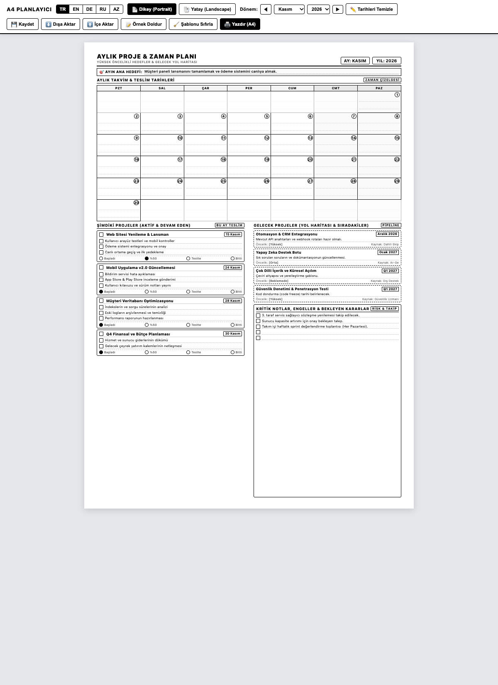
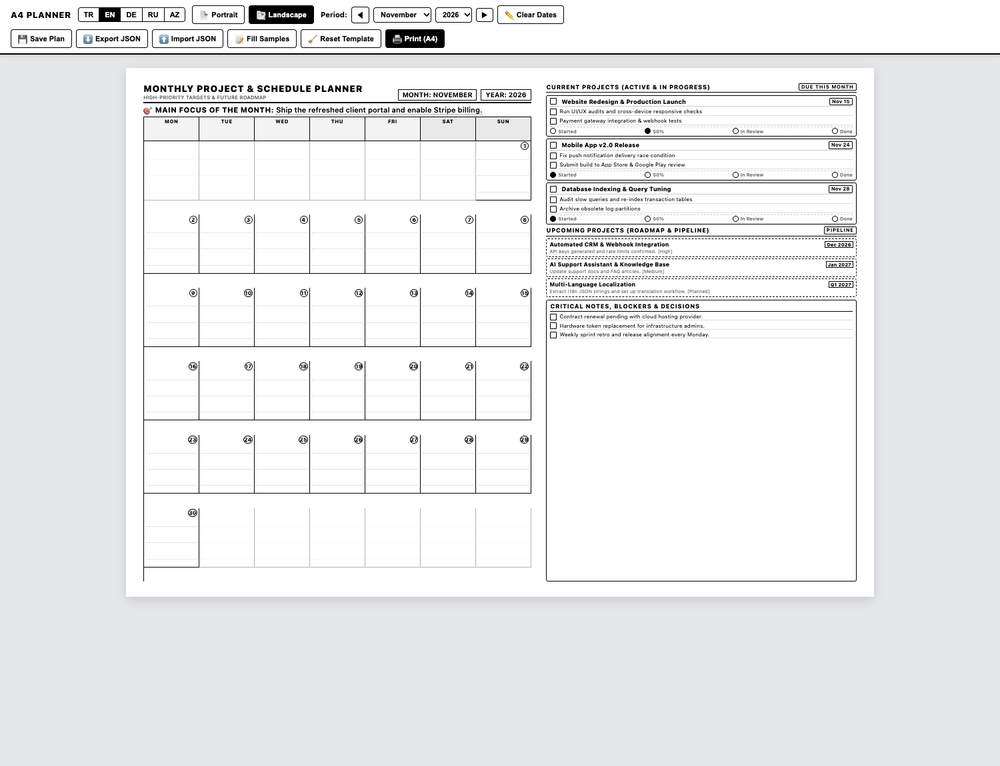

# Ежемесячный план проектов и календарь (Печать A4)

Минималистичный, экономящий чернила шаблон ежемесячного планировщика проектов и календаря на одном листе A4. Предназначен для черно-белой печати на бумаге или сохранения в PDF.

[ **English** ](README.md) | [ **Türkçe** ](README.tr.md) | [ **Русский** ] | [ **Azərbaycan** ](README.az.md)

**Онлайн демо:** [https://isihussain.github.io/monthly-project-planner-a4/](https://isihussain.github.io/monthly-project-planner-a4/)

---

## Скриншоты

### Вертикальный режим (Portrait)


### Горизонтальный режим (Landscape)


---

## Основные возможности

- **Экономия тонера и чернил:** Чистая черно-белая верстка с тонкими линиями без плотных темных заливок.
- **Гарантия одной страницы A4:** Точные CSS-стили печати предотвращают перенос строк и появление пустой второй страницы.
- **Мультиязычность:** Мгновенное переключение языка в один клик: **Русский (RU)**, **Английский (EN)**, **Турецкий (TR)**, **Азербайджанский (AZ)**.
- **Два формата отображения:**
  - **Вертикальный:** Календарь в верхней части, текущие и перспективные проекты в два столбца снизу.
  - **Горизонтальный:** Большие клетки календаря слева, карточки задач и блок заметок справа.
- **Редактирование прямо в браузере:** Все заголовки, названия задач, чекбоксы и дедлайны можно редактировать с клавиатуры перед печатью (`contenteditable`).
- **Автоматическая или ручная нумерация:** Выбор месяца и года автоматически расставляет дни недели, либо кнопка «Очистить даты» оставляет пустые кружки для ручного заполнения ручкой.
- **Без сторонних библиотек:** Чистый HTML, CSS и JavaScript. Работает автономно без сервера и подключения к сети.

---

## Структура шаблона

1. **Заголовок и фокус месяца:** Месяц, год и строка главной стратегической цели на месяц.
2. **Сетка календаря на месяц:** 35 ячеек (понедельник — воскресенье) с бейджами дат и линиями для записей.
3. **Текущие проекты (Активные):** До 4 активных проектов с дедлайнами, чекбоксами подзадач (`[ ]`) и индикаторами статуса (`Начат`, `50%`, `Тест`, `Готов`).
4. **Будущие проекты (План и дорожная карта):** Задачи в очереди, планируемые сроки, условия старта и приоритеты.
5. **Важные заметки и блокеры:** Разлинованная область для рисков, согласований и внешних зависимостей.

---

## Быстрый старт

### 1. Открытие в браузере

В терминале:
```bash
open index.html
```
Или откройте файл `index.html` двойным кликом в проводнике.

Поддерживаются параметры в URL:
- `index.html?lang=ru&mode=portrait`
- `index.html?lang=ru&mode=landscape`

### 2. Настройки печати (`Cmd + P` или `Ctrl + P`)

- **Принтер:** Ваш принтер или «Сохранить как PDF»
- **Размер бумаги:** A4
- **Цвет:** Черно-белый / Монохромный
- **Поля:** По умолчанию (или 8 мм)
- **Параметры:** Включите галочку **«Фоновая графика»** (необходимо для отображения рамок и линий).

---

## Структура репозитория

```text
├── index.html                  # Основной интерактивный файл шаблона
├── assets/
│   ├── preview-portrait.png    # Скриншот вертикального шаблона
│   └── preview-landscape.png   # Скриншот горизонтального шаблона
├── CONTRIBUTING.md             # Руководство для участников
├── LICENSE                     # Лицензия MIT
├── README.md                   # Документация на английском
├── README.tr.md                # Документация на турецком
├── README.ru.md                # Документация на русском
└── README.az.md                # Документация на азербайджанском
```

---

## Участие в разработке

Вы можете добавлять новые языки, улучшать стили печати или сообщать об ошибках. Подробности в файле [CONTRIBUTING.md](CONTRIBUTING.md).

---

## Лицензия

Проект распространяется под открытой лицензией [MIT](LICENSE).
