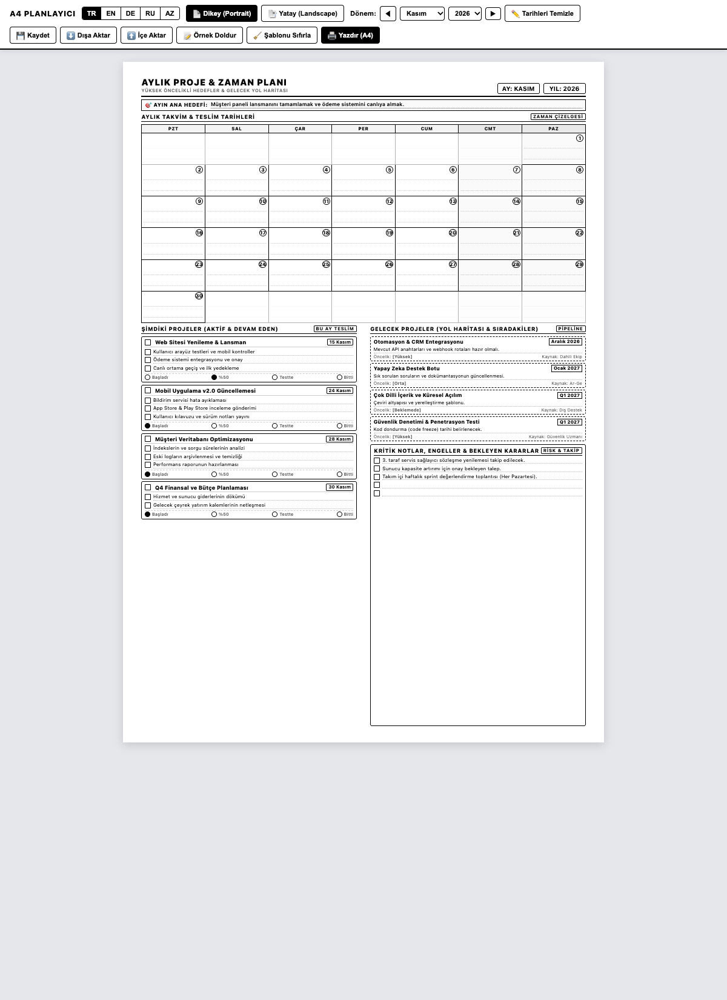
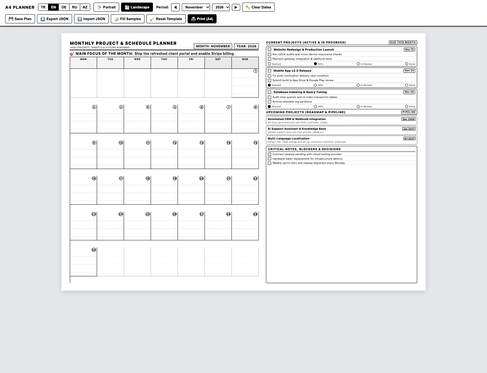

# Aylık Proje ve Takvim Planlayıcı (Yazdırılabilir A4)

A4 kağıdına tek sayfa olarak basılabilen, siyah-beyaz, yüksek kontrastlı ve mürekkep tasarruflu aylık proje ve zaman planlayıcısı.

[ **English** ](README.md) | [ **Türkçe** ] | [ **Русский** ](README.ru.md) | [ **Azərbaycan** ](README.az.md)

**Canlı Kullanım (Web):** [https://isihussain.github.io/monthly-project-planner-a4/](https://isihussain.github.io/monthly-project-planner-a4/)

---

## Ekran Görüntüleri

### Dikey Görünüm (Portrait)


### Yatay Görünüm (Landscape)


---

## Öne Çıkan Özellikler

- **Siyah-Beyaz & Mürekkep Tasarrufu:** Toner ve kartuş harcamayan, gereksiz koyu zeminlerden arındırılmış temiz çizgi tasarımı.
- **Tek Sayfa A4 Garantisi:** Milimetrik CSS print kuralları (`210mm × 297mm`) ile ikinci sayfaya taşma yapmaz.
- **Çok Dilli Destek:** Tek tıkla **Türkçe (TR)**, **İngilizce (EN)**, **Rusça (RU)** ve **Azerbaycan Türkçesi (AZ)** geçişi.
- **Çift Yerleşim Düzeni:**
  - **Dikey (Portrait):** Üstte takvim, altta iki sütunlu aktif proje ve yol haritası paneli.
  - **Yatay (Landscape):** Solda geniş takvim kutuları, sağda proje listeleri ve not alanı.
- **Tarayıcıda Düzenlenebilir:** Yazdırmadan önce tüm başlıklar, proje isimleri, görevler ve tarihler tıklanarak klavyeyle düzenlenebilir (`contenteditable`).
- **Otomatik veya Manuel Tarihlendirme:** Ay ve yıl seçilerek takvim günleri otomatik dizilebilir veya "Tarihleri Temizle" seçeneğiyle tamamen boş şablon basılabilir.
- **Sıfır Bağımlılık:** Framework veya kütüphane gerektirmez. Sade HTML, CSS ve JavaScript ile doğrudan çevrimdışı çalışır.

---

## Şablon Bölümleri

1. **Başlık ve Ayın Ana Odağı:** Ay, yıl ve ay boyunca odaklanılacak en kritik hedef satırı.
2. **Aylık Takvim Izgarası:** Pazartesi - Pazar 35 hücreli takvim, gün rozetleri ve not çizgileri.
3. **Şimdiki Projeler (Aktif):** 4 eşzamanlı proje, teslim tarihleri, alt görev kutucukları (`[ ]`) ve aşama göstergeleri (`Başladı`, `%50`, `Testte`, `Bitti`).
4. **Gelecek Projeler (Yol Haritası):** Sırada bekleyen projeler, hedef tarihler, ön koşullar ve öncelik seviyeleri.
5. **Kritik Notlar & Engeller:** Bekleyen onaylar, dış bağımlılıklar ve riskler için çizgili not alanı.

---

## Hızlı Başlangıç

### 1. Tarayıcıda Açma

Terminalden çalıştırmak için:
```bash
open index.html
```
veya dosya yöneticisinde `index.html` dosyasına çift tıklayın.

Doğrudan dil veya görünüm parametresiyle açabilirsiniz:
- `index.html?lang=tr&mode=portrait`
- `index.html?lang=tr&mode=landscape`

### 2. Yazdırma Ayarları (`Cmd + P` veya `Ctrl + P`)

- **Hedef:** Yazıcınız veya "PDF Olarak Kaydet"
- **Kağıt Boyutu:** A4
- **Renk:** Siyah-Beyaz / Monochrome
- **Kenar Boşlukları:** Varsayılan (veya 8mm)
- **Seçenekler:** **"Arka plan grafikleri"** kutucuğunu işaretleyin (çizgilerin ve kutuların net çıkması için).

---

## Proje Dizini

```text
├── index.html                  # Ana planlayıcı uygulaması
├── assets/
│   ├── preview-portrait.png    # Dikey ekran görüntüsü
│   └── preview-landscape.png   # Yatay ekran görüntüsü
├── CONTRIBUTING.md             # Katkı rehberi
├── LICENSE                     # MIT Lisansı
├── README.md                   # İngilizce dokümantasyon
├── README.tr.md                # Türkçe dokümantasyon
├── README.ru.md                # Rusça dokümantasyon
└── README.az.md                # Azerbaycan dili dokümantasyonu
```

---

## Katkıda Bulunma

Yeni diller ekleyebilir, yazdırma stillerini geliştirebilir veya hata bildiriminde bulunabilirsiniz. Katkı kuralları için [CONTRIBUTING.md](CONTRIBUTING.md) dosyasına göz atabilirsiniz.

---

## Lisans

Bu proje [MIT Lisansı](LICENSE) kapsamında açık kaynak olarak sunulmuştur.
